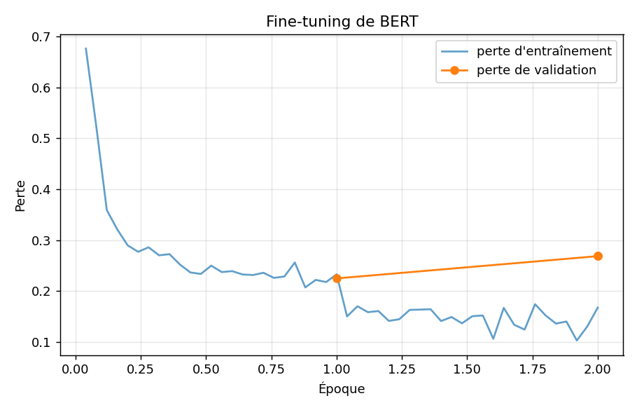
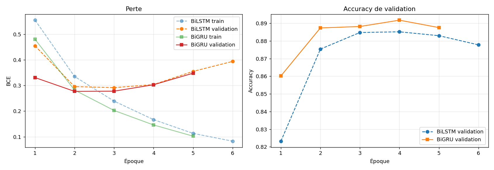

# 🎭 Sentiment analysis on IMDB: fine-tuned BERT vs BiLSTM / BiGRU

> **Analyse de sentiment : fine-tuning de BERT vs LSTM.** Binary sentiment classification of 50,000 IMDB reviews, comparing a fine-tuned `bert-base-uncased` (Hugging Face `Trainer`) with bidirectional LSTM and GRU baselines on GloVe embeddings, all evaluated on the **same held-out test set**. Notebooks are written in French.

## Results

Test set: **5,000 reviews** never used for training or model selection. All models share the same stratified 80 / 10 / 10 split (seed 42); the notebooks print a fingerprint of the test set, and it is identical in both (`f158b26f6f35`). Trained on a single Tesla T4 (Google Colab).

| Model | Accuracy | 95 % CI | Precision | Recall | F1 | Train time | Parameters |
|---|---|---|---|---|---|---|---|
| BiLSTM (GloVe 100d) | **88.50 %** | 87.6 to 89.4 % | 0.890 | 0.879 | 0.884 | 1.7 min | 6.8 M |
| BiGRU (GloVe 100d) | **89.50 %** | 88.6 to 90.3 % | 0.883 | 0.911 | 0.897 | 1.3 min | 6.7 M |
| **BERT-base, fine-tuned** | **93.08 %** | 92.3 to 93.8 % | 0.928 | 0.934 | 0.931 | 17.7 min | 109.5 M |

Intervals are 95 % Wilson intervals on the test accuracy. The table is rebuilt from the saved metrics with `python scripts/summarize_results.py`.

| BERT fine-tuning | BiLSTM vs BiGRU |
|---|---|
|  |  |

### What the numbers say

- **BERT beats the best recurrent model by 3.6 points** (93.1 % vs 89.5 %), and the confidence intervals do not overlap, so the gap is not a matter of test-set noise.
- **BiGRU vs BiLSTM is inconclusive**: a 1-point gap with overlapping intervals, from a single run each. I would not claim that GRU is better on this data.
- **The cost is real**: BERT needed about 14 times longer to train than the BiGRU and has 16 times more parameters. Most of the RNNs' 6.7 M parameters are the trainable embedding matrix (66,700 words × 100 dimensions); the recurrent layer itself is small.
- BERT's validation loss rises in the second epoch (0.225 → 0.268) while validation accuracy still improves (92.2 % → 92.5 %), a sign of growing over-confidence. The best checkpoint was selected on validation accuracy.

### Limitations

- **One run per model, one seed.** No variance estimate across seeds, no significance test between models.
- **No hyper-parameter search.** All settings are reasonable defaults (listed below), not tuned values.
- **Truncation differs.** The RNNs keep the first 200 words of a review; BERT keeps 256 tokens, which still cuts 40.8 % of the training reviews. A longer context would probably help BERT; it was not tested.
- **Preprocessing differs by design.** The RNNs use lowercased, punctuation-free word tokens; BERT uses its own WordPiece tokenizer on the raw text.
- One dataset (English movie reviews); the results say nothing about other domains or languages.

## Setup used

| | BiLSTM / BiGRU | BERT |
|---|---|---|
| Input | words, max 200, GloVe 6B 100d (fine-tuned) | WordPiece, max 256 tokens |
| Architecture | 1 bidirectional layer, 64 units, dropout 0.5, packed sequences | `bert-base-uncased` + classification head |
| Optimiser | Adam, lr 1e-3, weight decay 1e-5, gradient clipping 5 | AdamW, lr 2e-5, weight decay 0.01, 10 % warmup, fp16 |
| Batch size | 64 | 16 |
| Stopping | early stopping on validation loss (patience 3, max 15 epochs) | 2 epochs, best checkpoint on validation accuracy |
| Vocabulary | training set only, words seen at least twice (66,700) | pre-trained |

The recurrent models read **packed sequences**, so padding never reaches the recurrent state. Without it, short reviews would be classified from a state that has "read" many padding tokens, which would handicap the baseline unfairly.

## Reproduce

The notebooks were run on Google Colab (T4 GPU) with Python 3.13, PyTorch 2.14 and Transformers 5.22. Data and GloVe vectors are downloaded automatically.

1. Open the notebook in [Colab](https://colab.research.google.com) (*File → Upload notebook*) and select a **GPU** runtime.
2. Run all cells. `01_lstm_gru_baseline.ipynb` takes about 10 to 20 minutes, `02_bert_finetuning.ipynb` about 20 to 30 minutes.
3. Each notebook writes its metrics to `results/`. Compare the two with:

```bash
pip install -r requirements.txt   # only needed for the summary script locally
python scripts/summarize_results.py
```

The summary script refuses to compare the runs if their test-set fingerprints differ.

## Repository structure

```
.
├── notebooks/
│   ├── 01_lstm_gru_baseline.ipynb   # data, preprocessing, GloVe, BiLSTM and BiGRU, error analysis
│   └── 02_bert_finetuning.ipynb     # tokenisation, Trainer fine-tuning, evaluation, error analysis
├── results/
│   ├── lstm_gru_metrics.json        # metrics, config, training history (BiLSTM, BiGRU)
│   ├── bert_metrics.json            # metrics, config, training log (BERT)
│   ├── comparison.md                # generated comparison table
│   └── *_curves.png
├── scripts/summarize_results.py
└── requirements.txt
```

Both notebooks keep their saved outputs, including a sample of misclassified test reviews with the predicted probability.

## Data

- **Reviews**: Large Movie Review Dataset ([Maas et al., ACL 2011](https://ai.stanford.edu/~amaas/data/sentiment/)), loaded through the Hugging Face dataset [`stanfordnlp/imdb`](https://huggingface.co/datasets/stanfordnlp/imdb). The 25,000 training and 25,000 test reviews are merged into 50,000 balanced reviews and re-split. It is **not** the original train / test split, so numbers are not directly comparable with published IMDB benchmarks.
- **Embeddings**: [GloVe 6B, 100 dimensions](https://nlp.stanford.edu/projects/glove/) (Pennington et al., 2014), downloaded at run time and not redistributed here.

## License

Code: not yet licensed (add a `LICENSE` file to choose). Datasets and embeddings keep their own licenses.
